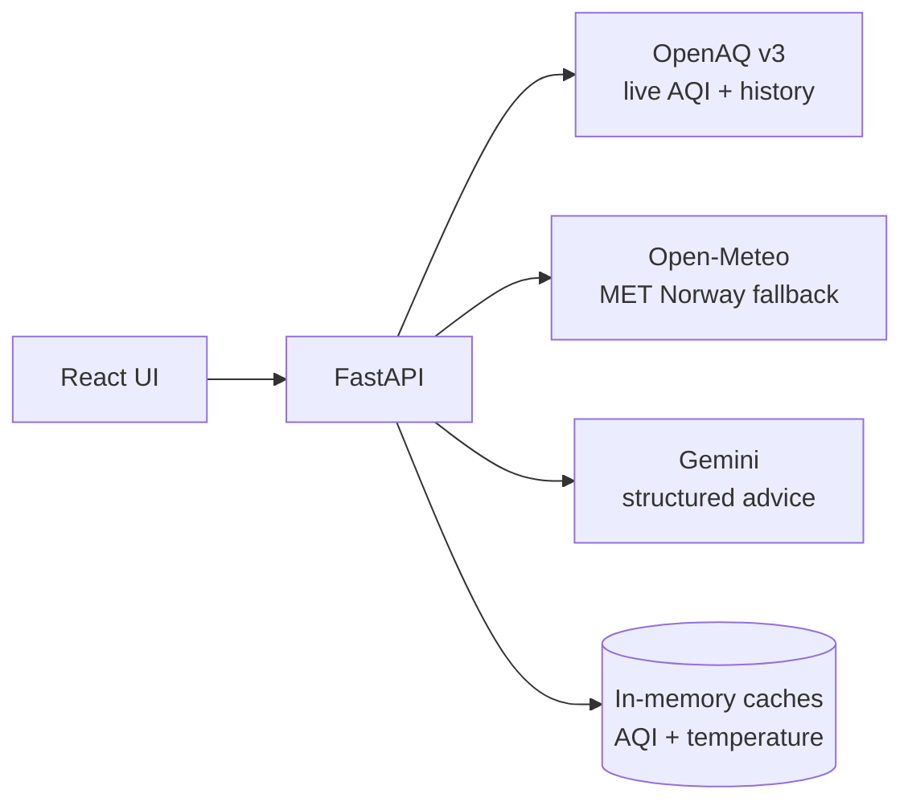

# 🌫️ Urban Air Quality Assistant

**Live AQI in, personalised "what should I do today?" out.**
Two people in the same city shouldn't get the same smog advice, so this app
doesn't give them the same advice.

> ### 🏆 Built for **Hack2skill PromptWars Virtual · Challenge 6**
> Solo entry · Generative AI for urban air quality and healthier daily choices.


## 💡 Why this exists

Winter smog in Indian cities is a daily decision problem: can my child play
outside, should my parents walk this evening, is it worth taking the car? An
AQI number alone doesn't answer that. This app turns real, current readings
into specific, explained actions for a specific person.

## ✨ What it does

- 📡 **Live air quality** for Delhi, Mumbai, Kolkata, Chennai, Bengaluru and
  Hyderabad: PM2.5, PM10, CPCB AQI category, station, and observation time
- 🤖 **Personalised plan** from Gemini as structured JSON: time-slotted daily
  routine, indoor air actions, and sustainable swaps, each with a plain-language
  *"why this helps"*
- 👨‍👩‍👧 **Persona comparison:** the same city and AQI, side by side for different people
- 📈 **History view:** recent AQI trend, with gaps left as gaps
- ✅ **Honest about data:** if the provider fails, you see the last real reading
  labelled stale with its timestamp; if there is none, you see "no data"
  instead of a made-up number

## 🎯 Same city, different advice

| Persona | What changes in the advice |
|---|---|
| 👨‍👩‍👧 Family with children | Outdoor play go/limited/no-go, school commute, indoor play ideas |
| 👵 Senior citizen | More cautious thresholds, lower-exertion options |
| 💼 Working professional | Commute and office air |
| 🎓 Student | Outdoor activities, study-space air |

[FILL: paste one real example, e.g. Delhi, same AQI, two personas, 2-3 lines each]

## 🧩 How it works



🔒 Keys stay on the backend. The browser never talks to OpenAQ or Gemini.

## 🔌 API

Interactive docs at `/docs`. Main endpoints:

| Endpoint | Purpose |
|---|---|
| `GET /api/aqi?city=Delhi` | Live AQI, history, temperature, source and valid time |
| `POST /api/advice` | Personalised plan from a profile |
| `GET /api/health` | Health check |

Rate limits: 30/min (AQI) and 10/min (advice) per client.
Temperature uses Open-Meteo with MET Norway as a fallback and caches each
city's result for up to three hours to limit requests from shared hosting IPs.
Weather source and forecast valid time are included in the AQI response.

## 🧠 Prompt engineering

Prompts are versioned in `backend/app/prompts/`. Gemini is asked for a strict
JSON schema, and the response is re-validated with Pydantic, with one retry on
malformed output.

| Version | What changed | Why |
|---|---|---|
| v1 | Baseline: role, live AQI context, persona safety rules, JSON output, stale-reading disclosure | Establish a working structured-output starting point |
| v2 | Labelled context block, priority order for exposure reduction, 3-5 routine actions, clearer persona and swap constraints, no-purifier alternatives | Cut generic advice; focus on actions the user can take today |
| v3 | Decision-first format, child-family go/limited/no-go, commute-specific rules, severe-smog guidance, concise output counts, guardrails against unsupported thresholds and medical certainty | Consistent persona output that is concise, evidence-bounded and easy to compare side by side |

v3 is the current production prompt. Full history and the test matrix:
[docs/prompt_evolution.md](docs/prompt_evolution.md).

## 📊 Evaluation

An offline harness runs persona × city × AQI-bucket cases through the real
advice service and scores deterministic checks (schema validity, "why it
helps" coverage, safety rules, persona differentiation). AQI values in the
cases are test inputs only and are never imported by the app.

[FILL after real runs: results table per prompt version, numbers copied from
`backend/evals/results/`]

Run it yourself: `cd backend && python -m evals.run_eval --prompt v3`.
The checks are heuristic and don't replace expert review.

## 🧪 Testing

```bat
.venv\Scripts\python -m pytest backend/tests
```

Covers health, city allowlist, schemas, AQI parsing and caching, weather
handling, the advice endpoint, and the eval checks.

## 🚀 Quick start

Needs Python 3.10+, Node 18+, an OpenAQ API key and a Gemini API key.

```bash
git clone https://github.com/aadarsh-create/prompt-wars && cd prompt-wars
cp .env.example .env        # Windows: copy .env.example .env  (then add keys)

# backend
python -m venv .venv
source .venv/bin/activate   # Windows: .venv\Scripts\activate
pip install -r backend/requirements.txt
cd backend && uvicorn app.main:app --reload

# frontend (new terminal)
cd frontend && npm install && npm run dev
```

Open http://localhost:5173. API docs are at http://localhost:8000/docs.
`.env` is gitignored, so never commit keys.

